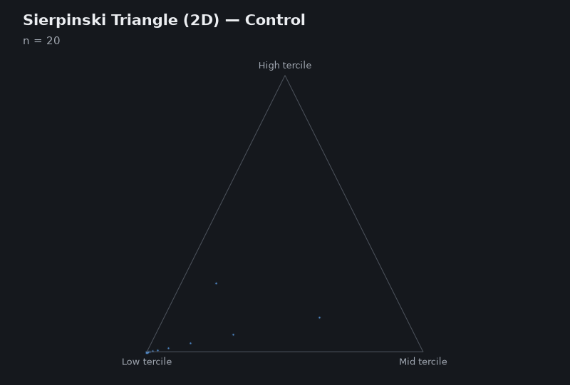

# Multiscale Fractal Complexity of Cardiac Variability: A Biomarker for Seizures

**FractalApp** — Chaos Game Representation and fractal dimension analysis of physiological time series

**Authors:** Alma Rocío Patiño-Chávez, Gael Aguirre-Cruz, Erik Leonardo Mateos-Salgado, Salvador Quiroz-González, Federico Menéndez-Conde Lara and Erika Elizabeth Rodríguez-Torres

**Version:** 1.0

---

## Overview

FractalApp is a graphical application written in Python (Tkinter) that maps a one-dimensional time series, such as a sequence of cardiac RR intervals (heart rate variability, HRV), onto a Sierpinski triangle (2D) or a Sierpinski tetrahedron (3D) through the Chaos Game algorithm. It estimates the fractal dimension of the resulting point set by box-counting.

Its purpose is to compare how completely the fractal attractor is filled by series from control subjects and from patients, including recordings from different seizure states (preictal, ictal, postictal).

<p align="center">
  
</p>

<p align="center"><em>Sierpinski triangle and tetrahedron built point by point from <code>data/controls/N1.txt</code> (4000 RR intervals, Control mode).</em></p>

---

## Method

Given a series `y_1, ..., y_n`, the application proceeds as follows.

1. **Symbolization.** The values are ranked and split into equally sized groups: terciles for the triangle (3 symbols) and quartiles for the tetrahedron (4 symbols). Each sample receives the symbol of the group its value belongs to, while keeping its original position in time.
2. **Chaos Game.** Starting from the centre of the figure, for every sample in temporal order the current point moves halfway towards the vertex associated with that sample's symbol. The sequence of visited points forms the representation.
3. **Fractal dimension.** The point cloud is normalised to the unit square (or cube) and the number of occupied boxes `N(ε)` is counted for a range of box sizes `ε`. The dimension `D` is the slope of `log N(ε)` against `log(1/ε)`:
   - 2D: 10 box sizes, log-spaced between 10⁻³ and 1.
   - 3D: 10 box sizes, log-spaced between 0.005 and 0.3.

If the symbols are independent and equiprobable, the points fill the whole Sierpinski attractor (theoretical dimension log 3 / log 2 ≈ 1.585 for the triangle and 2 for the tetrahedron). Temporal correlations make some symbol sequences rare or absent, leaving empty regions in the figure and lowering the estimated `D`.

### Generation modes

| Mode | Symbol assignment | Use |
|---|---|---|
| Control | Tercile / quartile of each value | Series from control subjects |
| Patient | Tercile / quartile of each value | Series from patients |
| Random | Uniformly random symbols (the triangle also shuffles the sample order) | Reference for an unstructured sequence |

The Control and Patient modes perform the same computation. They differ only in plot colour and labelling, so that the two groups can be told apart in exported figures.

### Methodological notes

- The box-counting estimate depends on the number of points. Compare series of the same length (the example files contain 4000 values each).
- Missing or non-numeric values must be removed beforehand. During ranking they would be placed in the highest group.
- The method is intended for series sampled once per event, such as one value per heartbeat. Signals sampled at a fixed high rate are strongly autocorrelated from one sample to the next, which by itself produces a poorly filled attractor.

---

## Features

- Loads single-column time series from `.txt`, `.csv` or `.dat` files.
- Converts gait recordings on load: ParkinSenseDB gyroscope files (`data.csv`) and PhysioNet gaitndd stride files (`.ts`). See [Supported input formats](#supported-input-formats).
- Generates the Sierpinski triangle (2D) and the Sierpinski tetrahedron (3D).
- Three generation modes: Control, Patient and Random.
- Estimates the fractal dimension by box-counting in 2D and 3D.
- Exports high-resolution PNG images and rotating GIF animations of the tetrahedron. The individual GIF frames are also saved as PNG files.
- Light or dark plot background.
- On Linux (X11), includes a file browser with search, which replaces the native Tk dialog.

---

## Repository structure

```
data/
  controls/        N1–N5: RR interval series from control subjects (4000 values each)
  epileptics/      E1–E5: RR interval series from patients with epilepsy (4000 values each)
  states/          Preictal, ictal and postictal series (3000 values each), with
                   example triangle, tetrahedron and GIF outputs; RANDOM holds the
                   random-mode reference figures
preview/           Interface screenshots and fractal.gif (2D and 3D construction)
src/
  interfaz2d3d.py        Main application
  giroscopio_a_serie.py  ParkinSenseDB gyroscope converter (used by the app and as a batch command)
  gaitndd_a_serie.py     PhysioNet gaitndd stride converter (used by the app and as a batch command)
  Software English.rar   Packaged executable, English interface
  Software Español.rar   Packaged executable, Spanish interface
requirements.txt
LICENSE
```

---

## Installation

Requires Python 3 with Tkinter.

```bash
git clone https://github.com/analisisenales/Multiscale-Fractal-Complexity-of-Cardiac-Variability-A-Biomarker-for-Seizures.git
cd Multiscale-Fractal-Complexity-of-Cardiac-Variability-A-Biomarker-for-Seizures

python -m venv venv
source venv/bin/activate        # Linux / macOS
venv\Scripts\activate           # Windows

pip install -r requirements.txt
```

Dependencies: `numpy`, `pandas`, `matplotlib`, `imageio`, `imageio-ffmpeg`, and `openpyxl` (only needed by the ParkinSenseDB batch command, which reads the demographics spreadsheet).

The application imports the two converters from `src/`, so keep the three `.py` files in the same folder.

---

## Usage

```bash
python src/interfaz2d3d.py
```

1. Click **Browse** and select a data file (see the formats below). The side panel shows the number of values and, for converted files, which conversion was applied.
2. Under the triangle or tetrahedron section, choose **Control**, **Patient** or **Random**.
3. The fractal dimension is shown in the side panel and above the figure.
4. Export the result with **Save Image (PNG)** or, for the tetrahedron, **Save GIF (3D)**.

### Supported input formats

The format is detected when the file is opened; no separate conversion step is needed.

| File | Detected by | What the app loads |
|---|---|---|
| Single-column series (`.txt`, `.csv`, `.dat`) | anything not listed below | the values as they are |
| ParkinSenseDB inertial recording (`data.csv`) | a header containing `Gyroscope` | `VM_ω = sqrt(ω_x² + ω_y² + ω_z²)` of the gyroscope, without sensor dropouts and without the standing intervals |
| PhysioNet gaitndd record (`.ts`) | the `.ts` extension | left stride intervals, without the first 20 s and without values more than 3 SD from the median |

A single-column file has one numeric value per line and no header, for example RR intervals:

```
0.977
1.016
0.945
```

Tab- or comma-separated files are accepted as long as they contain a single column.

A converted file keeps all its valid samples, so its length depends on the recording (for example, about 1800–2000 gyroscope samples for one ParkinSenseDB walk, or about 200–300 strides for one gaitndd record). Because `D` depends on the number of points, use the batch commands below when comparing groups.

---

## Converting whole datasets

The same converters can be run from the command line on a complete dataset. They write one single-column `.txt` file per subject, all with the same length `n`, sorted into one folder per group. Subjects with fewer than `n` valid samples are skipped. These files can then be opened in the app like any other series. The gait conversions are not part of the published HRV analysis.

**ParkinSenseDB (inertial sensors, 100 Hz).** Computes `VM_ω` for every repetition of one test (A: simple walk, B: narrowing walk, C: change of direction, D: Timed Up and Go), concatenates the repetitions in order, and writes the first `n` samples of each subject into `controls/` and `parkinson/`. The demographics spreadsheet supplies each subject's group.

```bash
python src/giroscopio_a_serie.py <Full_Dataset> <Demographic_Information.xlsx> <output_dir> [test A|B|C|D] [n=4000]
```

**PhysioNet gaitndd (Gait Dynamics in Neuro-Degenerative Disease).** Writes the first `n` cleaned left stride intervals of each subject into `controls/`, `parkinson/`, `huntington/` and `ela/`. The stride interval plays the role of the RR interval in gait: one value per cycle.

```bash
python src/gaitndd_a_serie.py <gaitndd/1.0.0> <output_dir> [n=190]
```

Notes on the data:

- `VM_ω` is sampled at 100 Hz, not once per event, so consecutive samples are strongly correlated (see [Methodological notes](#methodological-notes)).
- In both datasets the control groups are younger than the Parkinson's groups; compare them only with an adjustment for age.

---

## Building a standalone executable (optional)

```bash
pip install pyinstaller
pyinstaller --onefile --windowed src/interfaz2d3d.py
```

The executable is written to `dist/`. PyInstaller includes the two converters automatically because the application imports them. The prebuilt packages for both interface languages in `src/` predate the converters and read single-column files only.

---

## Citation

If you use this software in academic work, please cite:

> Patiño-Chávez, A. R., Aguirre-Cruz, G., Mateos-Salgado, E. L., Quiroz-González, S., Menéndez-Conde Lara, F., & Rodríguez-Torres, E. E. *Fractal-HRV-Analyzer: A Multiscale Software Framework to Analyze Seizures via Chaos Game Mapping.*

Once the article is published, cite the final journal version together with this repository.

---

## License

Distributed under the MIT License. See [LICENSE](LICENSE).

---

## Contact

Alma Rocío Patiño-Chávez — pa401981@uaeh.com

Corresponding author: Erika Elizabeth Rodríguez-Torres — erikart@uaeh.edu.mx
